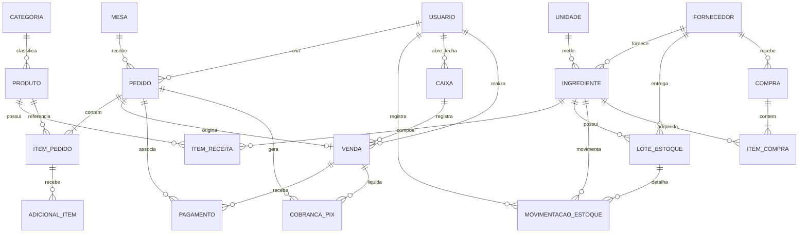

# Modelo conceitual — Estoque Fácil

Este modelo representa os conceitos do negócio e suas cardinalidades. O modelo
lógico completo, com atributos, tipos, chaves primárias e estrangeiras, está em
`estoque-facil.dbml`. O modelo físico MySQL permanece em
`src/database/mysql_schema.sql`.

## Entidades associativas

- `ITEM_RECEITA` resolve a relação N:N entre produto e ingrediente.
- `ITEM_COMPRA` resolve a relação N:N entre compra e ingrediente.
- `ITEM_PEDIDO` registra os produtos de cada pedido e preserva nome e preço
  históricos.

## Regras principais

- Um pedido pode estar ligado a uma mesa ou representar atendimento sem mesa.
- Um pedido contém um ou mais itens; a exclusão do pedido remove seus itens.
- Um produto pode possuir vários ingredientes por meio dos itens de receita.
- Uma venda pode receber vários pagamentos e cobranças PIX.
- Compras pertencem a um fornecedor e contêm um ou mais ingredientes.
- Movimentações registram entrada, saída, ajuste ou perda de ingredientes.
